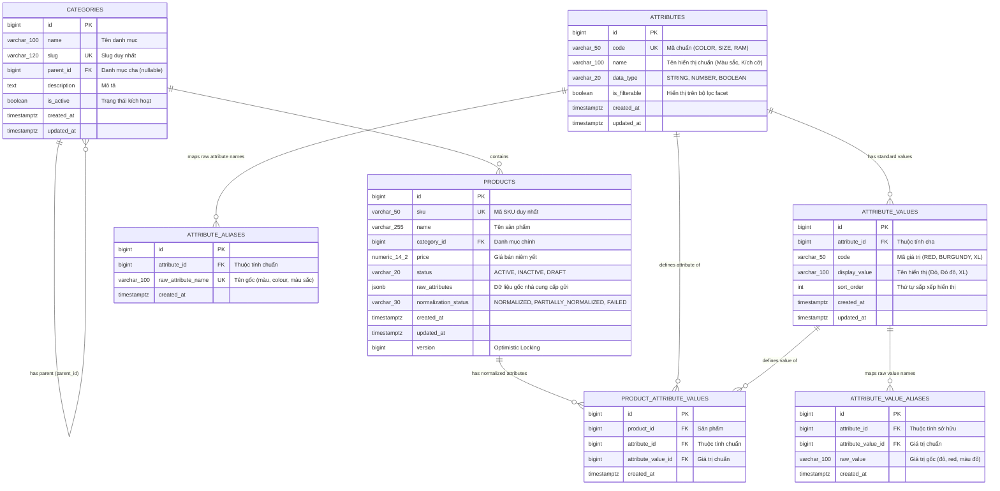

# NORMCAT — DATABASE DESIGN & ERD v1

Tài liệu này định nghĩa chi tiết mô hình cơ sở dữ liệu v1 cho dự án **NormCat**, bao gồm sơ đồ quan hệ thực thể (ERD Mermaid), cấu trúc bảng, khóa chính/ngoại, ràng buộc toàn vẹn và chiến lược đánh index trên PostgreSQL 16.

---

## 1. SƠ ĐỒ THỰC THỂ (ERD MERMAID)

---

## 2. DATA DICTIONARY CHI TIẾT

### 2.1. Bảng `categories`
- **Mục đích:** Quản lý danh mục hàng hóa theo cây phân cấp.
- **Cột & Kiểu dữ liệu:**
  - `id`: `BIGSERIAL PRIMARY KEY`
  - `name`: `VARCHAR(100) NOT NULL`
  - `slug`: `VARCHAR(120) NOT NULL UNIQUE`
  - `parent_id`: `BIGINT NULL REFERENCES categories(id) ON DELETE SET NULL`
  - `description`: `TEXT NULL`
  - `is_active`: `BOOLEAN NOT NULL DEFAULT TRUE`
  - `created_at`: `TIMESTAMPTZ NOT NULL DEFAULT CURRENT_TIMESTAMP`
  - `updated_at`: `TIMESTAMPTZ NOT NULL DEFAULT CURRENT_TIMESTAMP`

### 2.2. Bảng `attributes`
- **Mục đích:** Định nghĩa các thuộc tính chuẩn hóa của hệ thống.
- **Cột & Kiểu dữ liệu:**
  - `id`: `BIGSERIAL PRIMARY KEY`
  - `code`: `VARCHAR(50) NOT NULL UNIQUE` (ví dụ: `COLOR`, `SIZE`, `STORAGE`)
  - `name`: `VARCHAR(100) NOT NULL` (ví dụ: "Màu sắc", "Kích cỡ")
  - `data_type`: `VARCHAR(20) NOT NULL DEFAULT 'STRING'` (`STRING`, `NUMBER`, `BOOLEAN`)
  - `is_filterable`: `BOOLEAN NOT NULL DEFAULT TRUE`
  - `created_at`: `TIMESTAMPTZ NOT NULL DEFAULT CURRENT_TIMESTAMP`
  - `updated_at`: `TIMESTAMPTZ NOT NULL DEFAULT CURRENT_TIMESTAMP`

### 2.3. Bảng `attribute_values`
- **Mục đích:** Định nghĩa các giá trị chuẩn hợp lệ của từng thuộc tính.
- **Cột & Kiểu dữ liệu:**
  - `id`: `BIGSERIAL PRIMARY KEY`
  - `attribute_id`: `BIGINT NOT NULL REFERENCES attributes(id) ON DELETE CASCADE`
  - `code`: `VARCHAR(50) NOT NULL` (ví dụ: `RED`, `BURGUNDY`, `XL`)
  - `display_value`: `VARCHAR(100) NOT NULL` (ví dụ: "Đỏ", "Đỏ đô", "Extra Large")
  - `sort_order`: `INT NOT NULL DEFAULT 0`
  - `created_at`: `TIMESTAMPTZ NOT NULL DEFAULT CURRENT_TIMESTAMP`
  - `updated_at`: `TIMESTAMPTZ NOT NULL DEFAULT CURRENT_TIMESTAMP`
- **Ràng buộc:**
  - `UNIQUE (attribute_id, code)`

### 2.4. Bảng `attribute_aliases`
- **Mục đích:** Ánh xạ tên thuộc tính từ nhà cung cấp về thuộc tính chuẩn.
- **Cột & Kiểu dữ liệu:**
  - `id`: `BIGSERIAL PRIMARY KEY`
  - `attribute_id`: `BIGINT NOT NULL REFERENCES attributes(id) ON DELETE CASCADE`
  - `raw_attribute_name`: `VARCHAR(100) NOT NULL UNIQUE` (lowercase & trim, ví dụ: `'màu'`, `'colour'`, `'màu sắc'`)
  - `created_at`: `TIMESTAMPTZ NOT NULL DEFAULT CURRENT_TIMESTAMP`

### 2.5. Bảng `attribute_value_aliases`
- **Mục đích:** Ánh xạ giá trị thô từ nhà cung cấp về giá trị chuẩn.
- **Cột & Kiểu dữ liệu:**
  - `id`: `BIGSERIAL PRIMARY KEY`
  - `attribute_id`: `BIGINT NOT NULL REFERENCES attributes(id) ON DELETE CASCADE`
  - `attribute_value_id`: `BIGINT NOT NULL REFERENCES attribute_values(id) ON DELETE CASCADE`
  - `raw_value`: `VARCHAR(100) NOT NULL` (lowercase & trim, ví dụ: `'đỏ'`, `'red'`, `'màu đỏ'`)
  - `created_at`: `TIMESTAMPTZ NOT NULL DEFAULT CURRENT_TIMESTAMP`
- **Ràng buộc vàng (Data Integrity):**
  - `UNIQUE (attribute_id, raw_value)`
  - *Ý nghĩa:* Trong cùng một thuộc tính (ví dụ `COLOR`), chuỗi thô `'đỏ'` đã map vào `RED` thì không thể map vào `BURGUNDY`.

### 2.6. Bảng `products`
- **Mục đích:** Quản lý thông tin chính của sản phẩm, lưu trữ dữ liệu thô gốc.
- **Cột & Kiểu dữ liệu:**
  - `id`: `BIGSERIAL PRIMARY KEY`
  - `sku`: `VARCHAR(50) NOT NULL UNIQUE`
  - `name`: `VARCHAR(255) NOT NULL`
  - `category_id`: `BIGINT NOT NULL REFERENCES categories(id) ON DELETE RESTRICT`
  - `price`: `NUMERIC(14,2) NOT NULL`
  - `status`: `VARCHAR(20) NOT NULL DEFAULT 'ACTIVE'` (`ACTIVE`, `INACTIVE`, `DRAFT`)
  - `raw_attributes`: `JSONB NOT NULL DEFAULT '{}'::jsonb`
  - `normalization_status`: `VARCHAR(30) NOT NULL DEFAULT 'PENDING'` (`NORMALIZED`, `PARTIALLY_NORMALIZED`, `FAILED`)
  - `version`: `BIGINT NOT NULL DEFAULT 0` (Optimistic Locking)
  - `created_at`: `TIMESTAMPTZ NOT NULL DEFAULT CURRENT_TIMESTAMP`
  - `updated_at`: `TIMESTAMPTZ NOT NULL DEFAULT CURRENT_TIMESTAMP`

### 2.7. Bảng `product_attribute_values`
- **Mục đích:** Cầu nối liên kết N-N giữa sản phẩm và giá trị chuẩn hóa, phục vụ bộ lọc đa chiều (Faceted Search).
- **Cột & Kiểu dữ liệu:**
  - `id`: `BIGSERIAL PRIMARY KEY`
  - `product_id`: `BIGINT NOT NULL REFERENCES products(id) ON DELETE CASCADE`
  - `attribute_id`: `BIGINT NOT NULL REFERENCES attributes(id) ON DELETE CASCADE`
  - `attribute_value_id`: `BIGINT NOT NULL REFERENCES attribute_values(id) ON DELETE CASCADE`
  - `created_at`: `TIMESTAMPTZ NOT NULL DEFAULT CURRENT_TIMESTAMP`
- **Ràng buộc:**
  - `UNIQUE (product_id, attribute_id, attribute_value_id)`

---

## 3. CHIẾN LƯỢC INDEXING (POSTGRESQL PERFORMANCE TUNING)

| Bảng | Tên Index | Cột Index | Loại Index | Mục đích kỹ thuật |
|---|---|---|---|---|
| `products` | `idx_products_category_status` | `(category_id, status)` | B-Tree | Tối ưu khi lọc danh sách sản phẩm theo danh mục và trạng thái ACTIVE. |
| `products` | `idx_products_price` | `(price)` | B-Tree | Tối ưu lọc theo khoảng giá `minPrice` - `maxPrice` và sắp xếp giá tăng/giảm. |
| `product_attribute_values` | `idx_pav_search` | `(attribute_id, attribute_value_id, product_id)` | B-Tree (Composite) | **Index cốt lõi cho Facet Search:** Khi filter `COLOR=RED`, Postgres chỉ cần Index Scan trên index này để lấy ngay danh sách `product_id`. |
| `product_attribute_values` | `idx_pav_product` | `(product_id)` | B-Tree | Tối ưu truy vấn lấy toàn bộ thuộc tính chuẩn của 1 sản phẩm khi xem chi tiết. |
| `attribute_value_aliases` | `idx_ava_lookup` | `(attribute_id, raw_value)` | B-Tree | Tối ưu cho Normalization Engine khi tra cứu alias cực nhanh với độ phức tạp $O(\log N)$. |
