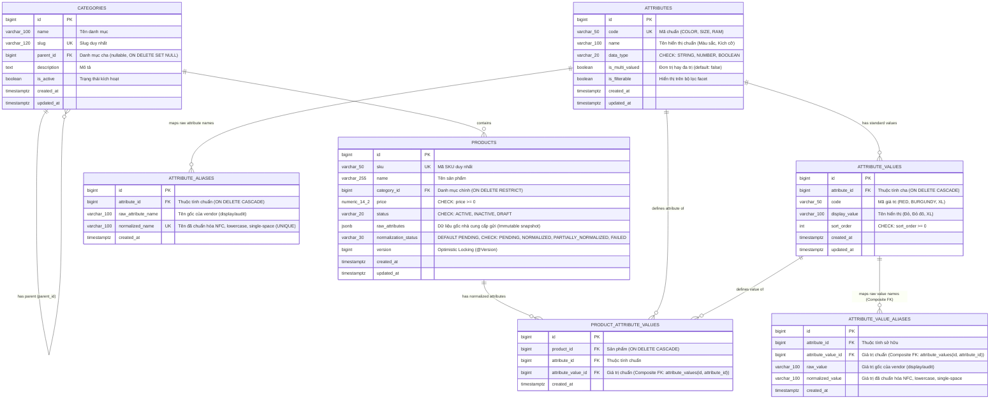
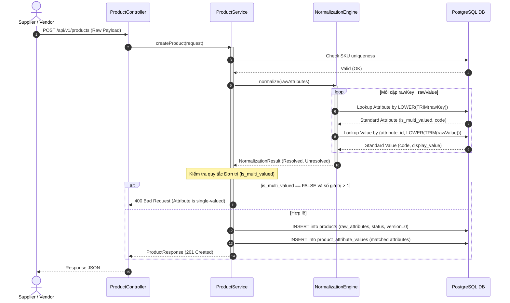

# NORMCAT — DATABASE DESIGN & ERD v1 (UPDATED)

Tài liệu này định nghĩa chi tiết mô hình cơ sở dữ liệu v1 cho dự án **NormCat**, bao gồm sơ đồ thực thể (ERD Mermaid), cấu trúc 7 bảng, ràng buộc toàn vẹn, composite foreign keys, expression indexes và cơ chế kiểm soát đơn trị / đa trị trên PostgreSQL 16.

---

## 1. SƠ ĐỒ THỰC THỂ (ERD MERMAID)



---

## 2. DATA DICTIONARY CHI TIẾT & RÀNG BUỘC TOÀN VẸN

### 2.1. Bảng `categories`
- `id`: `BIGSERIAL PRIMARY KEY`
- `name`: `VARCHAR(100) NOT NULL`
- `slug`: `VARCHAR(120) NOT NULL UNIQUE`
- `parent_id`: `BIGINT NULL REFERENCES categories(id) ON DELETE SET NULL`
- `description`: `TEXT NULL`
- `is_active`: `BOOLEAN NOT NULL DEFAULT TRUE`
- `created_at`, `updated_at`: `TIMESTAMPTZ NOT NULL DEFAULT CURRENT_TIMESTAMP`

### 2.2. Bảng `attributes`
- `id`: `BIGSERIAL PRIMARY KEY`
- `code`: `VARCHAR(50) NOT NULL UNIQUE`
- `name`: `VARCHAR(100) NOT NULL`
- `data_type`: `VARCHAR(20) NOT NULL DEFAULT 'STRING'`
  - **Constraint:** `CHECK (data_type IN ('STRING', 'NUMBER', 'BOOLEAN'))`
- `is_multi_valued`: `BOOLEAN NOT NULL DEFAULT FALSE`
  - *Ý nghĩa:* Thuộc tính đơn trị (`FALSE` - e.g. `BRAND`, `RAM`) chỉ cho phép tối đa 1 giá trị trên 1 sản phẩm. Thuộc tính đa trị (`TRUE` - e.g. `COLOR`, `MATERIAL`) cho phép nhiều giá trị.
- `is_filterable`: `BOOLEAN NOT NULL DEFAULT TRUE`
- `created_at`, `updated_at`: `TIMESTAMPTZ NOT NULL DEFAULT CURRENT_TIMESTAMP`

### 2.3. Bảng `attribute_values`
- `id`: `BIGSERIAL PRIMARY KEY`
- `attribute_id`: `BIGINT NOT NULL REFERENCES attributes(id) ON DELETE CASCADE`
- `code`: `VARCHAR(50) NOT NULL`
- `display_value`: `VARCHAR(100) NOT NULL`
- `sort_order`: `INT NOT NULL DEFAULT 0 CHECK (sort_order >= 0)`
- `created_at`, `updated_at`: `TIMESTAMPTZ NOT NULL DEFAULT CURRENT_TIMESTAMP`
- **Ràng buộc:**
  - `UNIQUE (attribute_id, code)`
  - `UNIQUE (id, attribute_id)` *(bổ sung để làm đích tham chiếu cho Composite Foreign Key từ bảng alias)*

### 2.4. Bảng `attribute_aliases`
- `id`: `BIGSERIAL PRIMARY KEY`
- `attribute_id`: `BIGINT NOT NULL REFERENCES attributes(id) ON DELETE CASCADE`
- `raw_attribute_name`: `VARCHAR(100) NOT NULL` *(Giá trị nguyên bản vendor gửi, dùng cho hiển thị/audit)*
- `normalized_name`: `VARCHAR(100) NOT NULL` *(Chuỗi đã chuẩn hóa: NFC Unicode, lowercased, gộp khoảng trắng thừa)*
- `created_at`: `TIMESTAMPTZ NOT NULL DEFAULT CURRENT_TIMESTAMP`
- **Unique Constraint:**
  - `CONSTRAINT uq_attr_alias_normalized UNIQUE (normalized_name)`
  *(Đảm bảo tính nhất quán 100% giữa Java StringNormalizer và Database, loại trừ triệt để sai khác giữa functional index và Unicode/khoảng trắng).*

### 2.5. Bảng `attribute_value_aliases`
- `id`: `BIGSERIAL PRIMARY KEY`
- `attribute_id`: `BIGINT NOT NULL`
- `attribute_value_id`: `BIGINT NOT NULL`
- `raw_value`: `VARCHAR(100) NOT NULL` *(Giá trị nguyên bản vendor gửi)*
- `normalized_value`: `VARCHAR(100) NOT NULL` *(Chuỗi đã chuẩn hóa: NFC Unicode, lowercased, gộp khoảng trắng thừa)*
- `created_at`: `TIMESTAMPTZ NOT NULL DEFAULT CURRENT_TIMESTAMP`
- **Composite Foreign Key (Đảm bảo nhất quán 100% giữa value và attribute):**
  ```sql
  CONSTRAINT fk_val_alias_composite
  FOREIGN KEY (attribute_value_id, attribute_id)
  REFERENCES attribute_values(id, attribute_id) ON DELETE CASCADE
  ```
- **Unique Constraint (Chống trùng lặp & xung đột alias trong cùng thuộc tính):**
  - `CONSTRAINT uq_val_alias_normalized UNIQUE (attribute_id, normalized_value)`

### 2.6. Bảng `products`
- `id`: `BIGSERIAL PRIMARY KEY`
- `sku`: `VARCHAR(50) NOT NULL UNIQUE`
- `name`: `VARCHAR(255) NOT NULL`
- `category_id`: `BIGINT NOT NULL REFERENCES categories(id) ON DELETE RESTRICT`
- `price`: `NUMERIC(14,2) NOT NULL CHECK (price >= 0)`
- `status`: `VARCHAR(20) NOT NULL DEFAULT 'ACTIVE' CHECK (status IN ('ACTIVE', 'INACTIVE', 'DRAFT'))`
- `raw_attributes`: `JSONB NOT NULL DEFAULT '{}'::jsonb`
- `normalization_status`: `VARCHAR(30) NOT NULL DEFAULT 'PENDING' CHECK (normalization_status IN ('PENDING', 'NORMALIZED', 'PARTIALLY_NORMALIZED', 'FAILED'))`
- `version`: `BIGINT NOT NULL DEFAULT 0` *(Optimistic Locking `@Version`)*
- `created_at`, `updated_at`: `TIMESTAMPTZ NOT NULL DEFAULT CURRENT_TIMESTAMP`

### 2.7. Bảng `product_attribute_values`
- `id`: `BIGSERIAL PRIMARY KEY`
- `product_id`: `BIGINT NOT NULL REFERENCES products(id) ON DELETE CASCADE`
- `attribute_id`: `BIGINT NOT NULL`
- `attribute_value_id`: `BIGINT NOT NULL`
- `created_at`: `TIMESTAMPTZ NOT NULL DEFAULT CURRENT_TIMESTAMP`
- **Composite Foreign Key (Bảo đảm tính toàn vẹn 100% giữa giá trị và thuộc tính):**
  ```sql
  CONSTRAINT fk_pav_attribute_value_composite 
  FOREIGN KEY (attribute_value_id, attribute_id) 
  REFERENCES attribute_values(id, attribute_id) ON DELETE CASCADE
  ```
  *(Ràng buộc này ngăn chặn triệt để lỗi logic khi gán giá trị của thuộc tính khác, ví dụ attribute_id = SIZE nhưng attribute_value_id lại thuộc COLOR).*
- **Unique Constraint:**
  - `UNIQUE (product_id, attribute_id, attribute_value_id)` *(ngăn chặn insert lặp cùng một giá trị cho một sản phẩm)*

---

## 3. CHIẾN LƯỢC INDEXING (POSTGRESQL PERFORMANCE TUNING)

| Bảng | Tên Index | Định nghĩa Index | Loại Index | Mục đích kỹ thuật |
|---|---|---|---|---|
| `products` | `idx_products_category_status` | `(category_id, status)` | B-Tree | Tối ưu lọc sản phẩm theo danh mục và trạng thái ACTIVE. |
| `products` | `idx_products_price` | `(price)` | B-Tree | Tối ưu lọc khoảng giá `minPrice` - `maxPrice` và sắp xếp giá. |
| `product_attribute_values` | `idx_pav_search` | `(attribute_id, attribute_value_id, product_id)` | B-Tree (Composite) | **Index cốt lõi cho Faceted Search:** Lọc sản phẩm theo thuộc tính chuẩn hóa siêu tốc. |
| `product_attribute_values` | `idx_pav_product` | `(product_id)` | B-Tree | Tối ưu lấy toàn bộ thuộc tính chuẩn của 1 sản phẩm khi xem chi tiết. |
| `attribute_aliases` | `uq_attr_alias_normalized` | `(normalized_name)` | B-Tree (Unique) | Tra cứu và chống trùng lặp alias tên thuộc tính đã chuẩn hóa NFC. |
| `attribute_value_aliases` | `uq_val_alias_normalized` | `(attribute_id, normalized_value)` | B-Tree (Composite Unique) | Tra cứu $O(\log N)$ và chống trùng lặp alias giá trị trong cùng thuộc tính. |

---

## 4. QUY TẮC NGHIỆP VỤ & LUỒNG THỰC THI (EXECUTION FLOW)

### 4.1. Cơ chế kiểm soát Đơn trị vs Đa trị (`is_multi_valued`)
- **Tại sao Database không thể tự kiểm soát đơn trị?**
  Unique constraint `(product_id, attribute_id, attribute_value_id)` ở bảng liên kết chỉ ngăn bản ghi trùng lặp (ví dụ không thể gán 2 lần giá trị `RED`). Nhưng nó **không thể ngăn** việc gán vừa `RED` vừa `BLUE` cho một thuộc tính.
- **Giải pháp xử lý tại Backend Service:**
  Khi Normalization Engine chuẩn bị lưu các giá trị chuẩn vào `product_attribute_values`:
  1. Kiểm tra cờ `is_multi_valued` của thuộc tính.
  2. Nếu `is_multi_valued == FALSE` (Đơn trị):
     - Đảm bảo trong payload hoặc trong DB của sản phẩm này chỉ có **tối đa 1 giá trị duy nhất**.
     - Nếu payload gửi nhiều giá trị cho thuộc tính đơn trị: Báo lỗi nghiệp vụ `BusinessException("Single-valued attribute cannot have multiple values")` hoặc lấy giá trị đầu tiên theo cấu hình.
  3. Nếu `is_multi_valued == TRUE` (Đa trị):
     - Cho phép lưu nhiều bản ghi giá trị khác nhau cho cùng một thuộc tính.
- **Chiến lược Concurrency chốt cho MVP: Khóa bi quan (Pessimistic Write Lock):**
  - *Vấn đề:* JPA `@Version` trên entity `Product` không tự động tăng (bump version) khi chỉ insert vào bảng con `product_attribute_values` mà không cập nhật trường nào trên bản ghi `products`. Khi 2 request đồng thời cùng kiểm tra thấy sản phẩm chưa có giá trị và cùng insert, race condition sẽ làm cả 2 bản ghi lọt vào DB!
  - *Chiến lược duy nhất & nhất quán:* Trong transaction gán thuộc tính hoặc chuẩn hóa, Service truy vấn `Product` với `SELECT ... FOR UPDATE` (`LockModeType.PESSIMISTIC_WRITE`) nằm trong một `@Transactional`.
  - Cơ chế này tuần tự hóa (serialize) các request cập nhật đồng thời trên cùng một sản phẩm, loại trừ triệt để race condition và không làm phức tạp hóa mô hình với việc pha trộn optimistic lock.

### 4.2. Quy tắc chuẩn hóa chuỗi và Unicode
- **Đồng bộ hóa 100% giữa Application Layer và Database:**
  - Nhằm tránh hoàn toàn sự sai lệch giữa Java regex / Unicode NFC và các hàm PostgreSQL (như khoảng trắng thừa liên tiếp `\s+` hay Unicode NFD/NFC), hệ thống sử dụng trường chuẩn hóa riêng biệt:
    - Bảng `attribute_aliases`: có cột `normalized_name` với `UNIQUE (normalized_name)`.
    - Bảng `attribute_value_aliases`: có cột `normalized_value` với `UNIQUE (attribute_id, normalized_value)`.
  - **Quy tắc tại Application Layer (`StringNormalizer`):**
    Trước khi lưu hoặc tra cứu, Java Service áp dụng quy tắc chuẩn hóa duy nhất:
    ```java
    public static String normalize(String raw) {
        if (raw == null) return null;
        return Normalizer.normalize(raw.trim(), Normalizer.Form.NFC)
                .toLowerCase()
                .replaceAll("\\s+", " ");
    }
    ```
  - Cột `raw_attribute_name` / `raw_value` vẫn được giữ nguyên bản để phục vụ audit log và hiển thị giao diện. Mọi tra cứu nghiệp vụ đều thực hiện trên `normalized_name` / `normalized_value` với tốc độ B-Tree index $O(\log N)$.

### 4.3. Sơ đồ chu trình xử lý (Sequence Diagram)


