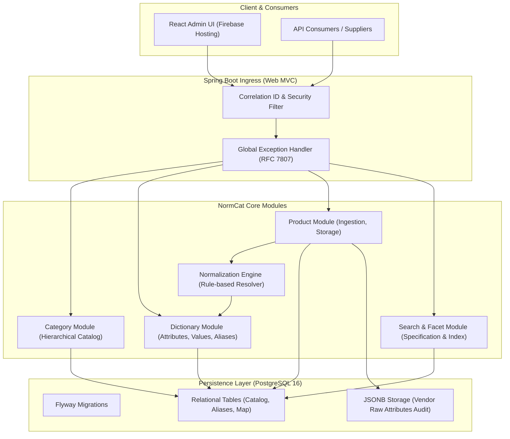

# NORMCAT — SYSTEM ARCHITECTURE & TECHNICAL DESIGN

Tài liệu này mô tả chi tiết kiến trúc tổng thể, phân rã module, chiến lược quản trị giao dịch (Transactions), xử lý lỗi (Exception Handling) và cấu trúc source code của dự án **NormCat**.

---

## 1. PHONG CÁCH KIẾN TRÚC: MODULAR MONOLITH

NormCat được thiết kế theo mô hình **Modular Monolith** trên nền tảng **Java 21** và **Spring Boot 3.3+**:
- Toàn bộ ứng dụng đóng gói thành một file JAR duy nhất có khả năng deploy độc lập.
- Các module nghiệp vụ được chia tách rõ ràng (Clean Domain Boundaries).
- Không lãng phí thời gian vào network latency, distributed transactions hay service discovery như Microservices.
- Sẵn sàng bóc tách thành các microservice riêng biệt trong tương lai khi lưu lượng tăng trưởng.



---

## 2. NGUYÊN TẮC PHỤ THUỘC GIỮA CÁC MODULE (DEPENDENCY RULES)

1. **Module `common`:** Chứa các thành phần dùng chung (Base Entity, Exception, PageResponse, Validation Utils). Tất cả các module khác đều có thể phụ thuộc vào `common`.
2. **Module `dictionary`:** Độc lập với `product` và `search`. Chỉ phục vụ quản trị danh mục thuộc tính, giá trị chuẩn và bảng bí danh alias.
3. **Module `normalization`:** Phụ thuộc vào `dictionary` để tra cứu từ điển quy tắc. Không phụ thuộc vào `product`.
4. **Module `product`:** Phụ thuộc vào `category` (để gán danh mục) và `normalization` (để chuẩn hóa dữ liệu khi tạo/cập nhật sản phẩm).
5. **Module `search`:** Module chỉ đọc (`read-only`), truy vấn trực tiếp dữ liệu từ bảng sản phẩm và bảng thuộc tính đã chuẩn hóa để tối ưu hiệu năng.

> [!NOTE]
> Tuyệt đối **không** tạo phụ thuộc vòng tròn (Circular Dependency) giữa các module. Mọi giao tiếp liên module diễn ra thông qua Service Interface hoặc Spring Application Events (In-memory).

---

## 3. CẤU TRÚC PACKAGE JAVA (PACKAGE BY FEATURE)

```
com.normcat
├── NormCatApplication.java
├── common
│   ├── config
│   │   ├── OpenApiConfig.java
│   │   └── WebMvcConfig.java
│   ├── exception
│   │   ├── BusinessException.java
│   │   ├── ResourceNotFoundException.java
│   │   ├── ConflictException.java
│   │   ├── ErrorCode.java
│   │   └── GlobalExceptionHandler.java
│   ├── response
│   │   ├── ApiResponse.java
│   │   └── PageResponse.java
│   └── entity
│       └── BaseAuditableEntity.java
└── modules
    ├── category
    │   ├── controller
    │   ├── dto
    │   ├── entity
    │   ├── repository
    │   └── service
    ├── dictionary
    │   ├── controller
    │   ├── dto
    │   ├── entity (Attribute, AttributeValue, AttributeAlias, ValueAlias)
    │   ├── repository
    │   └── service
    ├── normalization
    │   ├── engine (NormalizationEngine, NormalizationResult)
    │   └── service (NormalizationService)
    ├── product
    │   ├── controller
    │   ├── dto
    │   ├── entity (Product, ProductAttributeValue)
    │   ├── repository
    │   └── service
    └── search
        ├── controller
        ├── dto (SearchCriteria, FacetFilterRequest)
        ├── specification (ProductSearchSpecification)
        └── service
```

---

## 4. CHIẾN LƯỢC TRANSACTION & TOÀN VẸN DỮ LIỆU

1. **Transaction Boundary:**
   - Mọi phương thức ghi (Create/Update/Delete) trong Service Layer được khai báo `@Transactional(rollbackFor = Exception.class)`.
   - Các phương thức đọc khai báo `@Transactional(readOnly = true)` để Hibernate tối ưu Dirty Checking và giải phóng connection pool nhanh hơn.
2. **Tính nguyên tử trong luồng Ingestion (Atomicity):**
   - Khi tạo sản phẩm: Việc ghi vào bảng `products` (kèm `raw_attributes`) và ghi vào bảng `product_attribute_values` (các thuộc tính đã chuẩn hóa) nằm trong **cùng 1 Database Transaction**. Nếu một trong hai thất bại, toàn bộ rollback để tránh dữ liệu mồ côi (orphaned data).
3. **Optimistic Locking:**
   - Bảng `products` có cột `version` (`@Version` trong JPA) để phòng chống hiện tượng mất dữ liệu (Lost Update) khi có 2 Admin cùng lúc chỉnh sửa sản phẩm hoặc khi re-normalization chạy ngầm.

---

## 5. CHIẾN LƯỢC XỬ LÝ LỖI & VALIDATION (RFC 7807)

- **Chuẩn hóa phản hồi lỗi:** Áp dụng chuẩn **RFC 7807 Problem Details for HTTP APIs**.
- **Cấu trúc JSON phản hồi lỗi:**
  ```json
  {
    "timestamp": "2026-10-25T15:30:00Z",
    "status": 409,
    "error": "CONFLICT",
    "code": "ALIAS_ALREADY_EXISTS",
    "message": "The raw alias 'đỏ' already maps to attribute value 'RED'",
    "path": "/api/v1/dictionary/attributes/1/values/2/aliases"
  }
  ```
- **Validation:** Áp dụng `jakarta.validation` (`@NotBlank`, `@NotNull`, `@Size`, `@Pattern`) tại tầng DTO của Controller. Mọi lỗi validation trả về HTTP 400 Bad Request kèm chi tiết từng field bị lỗi.
