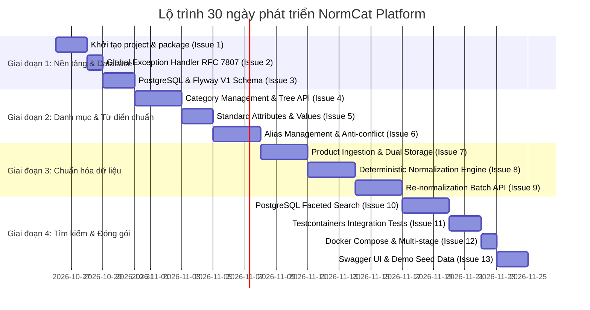

# NORMCAT — LỘ TRÌNH TRIỂN KHAI 30 NGÀY (ROADMAP) & QUY TRÌNH PHỐI HỢP AI

Tài liệu này xác lập kế hoạch phát triển 30 ngày cho dự án **NormCat**, phân bổ theo 4 giai đoạn cụ thể, liên kết trực tiếp với 13 GitHub Issues đã tạo và quy định cơ chế phối hợp giữa Project Owner và AI Assistants.

---

## 1. BẢNG TỔNG HỢP GITHUB ISSUES ĐÃ KHỞI TẠO

Toàn bộ 13 Issues đã được nạp lên GitHub với đầy đủ Acceptance Criteria và nhãn phân loại:

| Issue | Tiêu đề Issue | Epic / Nhóm | Priority | Estimate | Trạng thái |
|:---:|---|---|:---:|:---:|:---:|
| [#1](https://github.com/D60-ThinhLS-ImprovementPlan/normcat-backend/issues/1) | `feat: Khởi tạo Spring Boot 3.3 skeleton, cấu trúc package và công cụ build Maven` | Foundation | P0 | M (3h) | Ready |
| [#2](https://github.com/D60-ThinhLS-ImprovementPlan/normcat-backend/issues/2) | `feat: Cấu hình chuẩn hóa xử lý lỗi GlobalExceptionHandler theo chuẩn RFC 7807` | Foundation / Error | P0 | S (2h) | Ready |
| [#3](https://github.com/D60-ThinhLS-ImprovementPlan/normcat-backend/issues/3) | `feat: Thiết lập cấu hình PostgreSQL và Flyway migration script V1 (Init Schema & Indexes)` | Database | P0 | M (3h) | Ready |
| [#4](https://github.com/D60-ThinhLS-ImprovementPlan/normcat-backend/issues/4) | `feat: Phát triển CRUD danh mục sản phẩm và API cây phân cấp cha-con` | Category | P1 | M (3h) | Ready |
| [#5](https://github.com/D60-ThinhLS-ImprovementPlan/normcat-backend/issues/5) | `feat: Quản lý thuộc tính chuẩn (Attributes) và giá trị chuẩn (Attribute Values)` | Dictionary | P0 | M (3h) | Ready |
| [#6](https://github.com/D60-ThinhLS-ImprovementPlan/normcat-backend/issues/6) | `feat: Quản lý từ điển Alias cho thuộc tính và giá trị kèm cơ chế chống xung đột` | Dictionary | P0 | M (3h) | Ready |
| [#7](https://github.com/D60-ThinhLS-ImprovementPlan/normcat-backend/issues/7) | `feat: Phát triển API tạo và cập nhật sản phẩm hỗ trợ lưu trữ kép (Raw Attributes JSONB)` | Product Ingestion | P0 | M (4h) | Ready |
| [#8](https://github.com/D60-ThinhLS-ImprovementPlan/normcat-backend/issues/8) | `feat: Xây dựng Normalization Engine theo quy tắc xác thực (Deterministic Rule-based Resolver)` | Normalization | P0 | L (4h) | Ready |
| [#9](https://github.com/D60-ThinhLS-ImprovementPlan/normcat-backend/issues/9) | `feat: Phát triển API tái chuẩn hóa (Re-normalization) cho sản phẩm cũ khi có Alias mới` | Normalization | P1 | M (3h) | Ready |
| [#10](https://github.com/D60-ThinhLS-ImprovementPlan/normcat-backend/issues/10) | `feat: Xây dựng bộ lọc tìm kiếm sản phẩm đa diện (Faceted Search) và phân trang trên PostgreSQL` | Search & Facet | P0 | L (4h) | Ready |
| [#11](https://github.com/D60-ThinhLS-ImprovementPlan/normcat-backend/issues/11) | `test: Viết bộ kiểm thử tích hợp (Integration Tests) với Testcontainers PostgreSQL` | Testing | P0 | M (4h) | Ready |
| [#12](https://github.com/D60-ThinhLS-ImprovementPlan/normcat-backend/issues/12) | `ci: Đóng gói Dockerfile multi-stage và docker-compose.yml khởi chạy trọn gói` | DevOps | P1 | S (2h) | Ready |
| [#13](https://github.com/D60-ThinhLS-ImprovementPlan/normcat-backend/issues/13) | `docs: Tích hợp Swagger/OpenAPI 3.0 và viết kịch bản dữ liệu mẫu (Seed Data)` | Docs & Demo | P1 | S (2h) | Ready |

---

## 2. LỘ TRÌNH TRIỂN KHAI 30 NGÀY THEO GIAI ĐOẠN

### Giai đoạn 1 (Ngày 1 – 5): Nền tảng ứng dụng & Thiết lập Database
- **Mục tiêu:** Tạo skeleton dự án chuẩn mực, cấu hình kết nối database an toàn và xử lý lỗi tập trung.
- **Issues thực hiện:** [#1](https://github.com/D60-ThinhLS-ImprovementPlan/product-catalog-search/issues/1), [#2](https://github.com/D60-ThinhLS-ImprovementPlan/product-catalog-search/issues/2), [#3](https://github.com/D60-ThinhLS-ImprovementPlan/product-catalog-search/issues/3).
- **Kết quả kiểm chứng:** Ứng dụng chạy được, Flyway tự tạo 7 bảng trong PostgreSQL, gọi thử API lỗi trả về đúng chuẩn RFC 7807.
- **Tiêu chí hoàn thành (DoD):** Chạy `mvn test` pass 100%, database schema khớp hoàn toàn với ERD v1.

### Giai đoạn 2 (Ngày 6 – 13): Quản lý Danh mục & Từ điển quy tắc chuẩn hóa
- **Mục tiêu:** Hoàn thiện 2 module nghiệp vụ độc lập làm nền móng: Danh mục phân cấp và Từ điển thuộc tính/giá trị/alias.
- **Issues thực hiện:** [#4](https://github.com/D60-ThinhLS-ImprovementPlan/product-catalog-search/issues/4), [#5](https://github.com/D60-ThinhLS-ImprovementPlan/product-catalog-search/issues/5), [#6](https://github.com/D60-ThinhLS-ImprovementPlan/product-catalog-search/issues/6).
- **Kết quả kiểm chứng:** Gọi API tạo danh mục cha-con; tạo thuộc tính `COLOR` → giá trị `RED`, `BURGUNDY`; gán alias `"màu"` và `"đỏ"`. Thử insert alias trùng lặp bị chặn và trả về HTTP 409 Conflict.
- **Tiêu chí hoàn thành (DoD):** Có Unit/Integration test cho logic chống xung đột alias.

### Giai đoạn 3 (Ngày 14 – 22): Ingestion & Normalization Engine (Trái tim hệ thống)
- **Mục tiêu:** Xây dựng luồng tiếp nhận sản phẩm, lưu trữ dữ liệu thô (JSONB) và tự động chuẩn hóa dựa trên từ điển.
- **Issues thực hiện:** [#7](https://github.com/D60-ThinhLS-ImprovementPlan/product-catalog-search/issues/7), [#8](https://github.com/D60-ThinhLS-ImprovementPlan/product-catalog-search/issues/8), [#9](https://github.com/D60-ThinhLS-ImprovementPlan/product-catalog-search/issues/9).
- **Kết quả kiểm chứng:** Đẩy payload sản phẩm có `{"Màu": "Đỏ"}` → tự động map về `COLOR: RED`. Đẩy `{"Màu": "Đỏ đô"}` khi chưa có alias → lưu raw, gắn cờ `PARTIALLY_NORMALIZED`. Thêm alias cho `"Đỏ đô"` rồi gọi re-normalization API → sản phẩm tự chuyển sang `NORMALIZED`.
- **Tiêu chí hoàn thành (DoD):** Đảm bảo tính nguyên tử (Atomicity) trong transaction, không làm biến dạng dữ liệu gốc.

### Giai đoạn 4 (Ngày 23 – 30): Tìm kiếm Faceted Search, Testing & Đóng gói Demo
- **Mục tiêu:** Hoàn thiện bộ lọc tìm kiếm sản phẩm hiệu năng cao trên PostgreSQL, kiểm thử tự động toàn diện và đóng gói 1-click run.
- **Issues thực hiện:** [#10](https://github.com/D60-ThinhLS-ImprovementPlan/product-catalog-search/issues/10), [#11](https://github.com/D60-ThinhLS-ImprovementPlan/product-catalog-search/issues/11), [#12](https://github.com/D60-ThinhLS-ImprovementPlan/product-catalog-search/issues/12), [#13](https://github.com/D60-ThinhLS-ImprovementPlan/product-catalog-search/issues/13).
- **Kết quả kiểm chứng:** Tìm kiếm theo nhiều tiêu chí kết hợp (`category`, `price`, `attrs[COLOR]=RED`) trả về kết quả chính xác, dùng B-Tree index scan. Chạy `docker compose up -d` trên máy mới chạy được ngay kèm Swagger UI và dữ liệu mẫu thực tế.
- **Tiêu chí hoàn thành (DoD):** Chạy `mvn clean verify` pass toàn bộ Testcontainers integration tests. Sẵn sàng đem đi phỏng vấn.

---

## 3. QUY TRÌNH PHỐI HỢP GIỮA PROJECT OWNER VÀ AI

Để đảm bảo **ThinhLS (PO & Java Developer)** luôn làm chủ 100% dự án, hiểu từng dòng code và không bị AI làm loãng phạm vi, quy trình phối hợp được thiết lập như sau:

| Vai trò | Thành viên | Trách nhiệm chính | Quyền hạn |
|---|---|---|---|
| **Project Owner (PO)** | **ThinhLS** | Quyết định kiến trúc, công nghệ và scope; Trực tiếp review, commit và merge mã nguồn; Hiểu và kiểm soát toàn bộ code đưa vào dự án. | **Toàn quyền quyết định cuối cùng.** |
| **AI Project Manager** | AI Assistant | Quản lý tiến độ theo 13 issues; Nhắc nhở ranh giới MVP, ngăn chặn Scope Creep (không tự thêm Redis, Kafka...); Tạo checklist nghiệm thu chi tiết cho từng task. | Đề xuất & hỗ trợ quản lý. |
| **AI Tech Lead & Reviewer** | AI Assistant | Đề xuất giải pháp kỹ thuật, viết bản thảo code mẫu tối ưu; Phản biện kiến trúc, phát hiện sớm rủi ro (N+1 query, Race condition, Memory leak); Hướng dẫn viết test cases và tài liệu kỹ thuật. | Đề xuất & tư vấn. |

### Các nguyên tắc vận hành hàng ngày:
1. **Làm việc theo nhánh Git tương ứng với Issue:**
   - Mỗi task bắt đầu bằng việc tạo nhánh `feature/<issue-number>-<ten-task>` bắt nguồn từ `develop`.
   - Ví dụ: `feature/1-spring-boot-skeleton`, `feature/3-flyway-schema`.
2. **Review trước khi Code:**
   - Trước khi viết code cho 1 issue, AI tóm tắt ngắn gọn các class/interface sẽ tạo. ThinhLS duyệt qua cấu trúc → AI mới sinh code chi tiết.
3. **Quy tắc nghiệm thu Code:**
   - Bất kỳ đoạn code nào tạo ra đều phải đi kèm giải thích logic và hướng dẫn kiểm thử (Unit test hoặc cURL/Postman).
   - Code xong phải chạy test pass ở local trước khi tạo PR vào `develop`.
4. **Bộ nhớ phiên làm việc:**
   - Khi mở bất kỳ session mới nào, file `AGENTS.md` tại thư mục gốc sẽ tự động cung cấp ngữ cảnh đầy đủ để tiếp tục công việc ngay lập tức mà không cần nhắc lại từ đầu.
